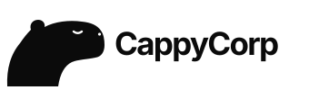
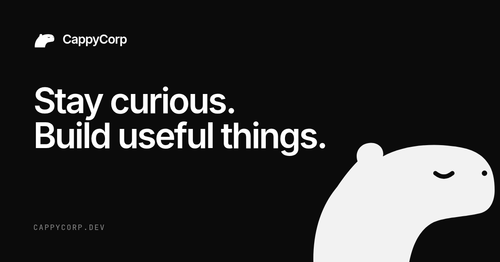
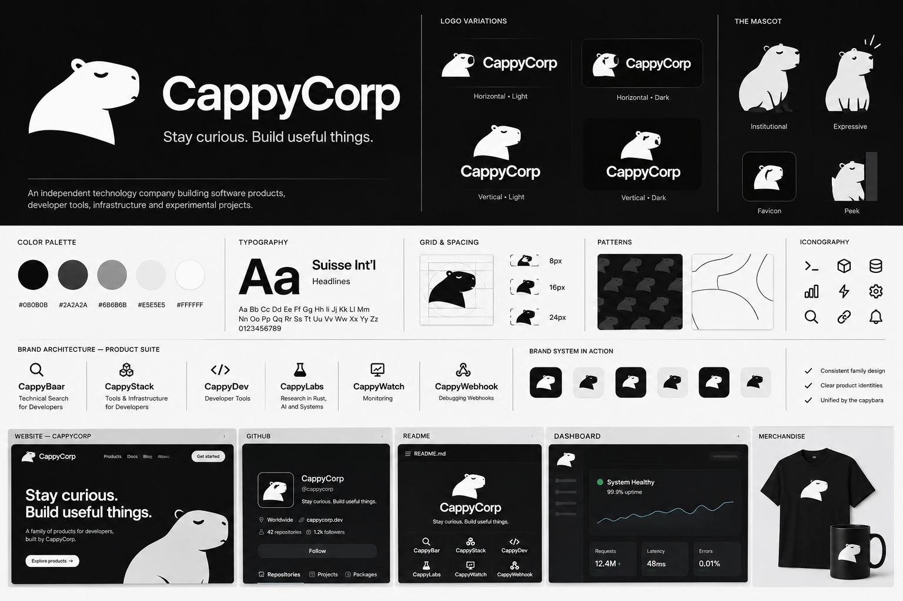
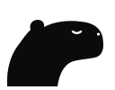
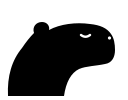
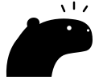

<p align="center">
  <picture>
    <source media="(prefers-color-scheme: dark)" srcset="branding/01-Logo/Wordmarks/cappycorp-horizontal-dark.svg">
    
  </picture>
</p>

<p align="center"><strong>Stay curious. Build useful things.</strong></p>

<p align="center">
  The website of CappyCorp, an independent technology company building software products,<br>
  developer tools, infrastructure and experimental projects.
</p>

<p align="center">
  
</p>

---

## What's on the page

The whole site is a single landing page that sits inside a thin editorial frame. Hairline rules split it into sections, and small `+` marks show where each rule crosses the frame.

| Section | What it does |
| --- | --- |
| **Hero** | The tagline appears word by word over slowly drifting light. Below it is a dashboard preview (example data) with the capybara peeking over its edge. The capybara follows your pointer, breathes, nods and hops when you hover it. |
| **Numbers** | Three quick facts that count up when they scroll into view. |
| **Products** | One cell per product, each with a small live illustration: a search being typed, layers stacking, code with a blinking cursor, orbiting research topics, latency bars and a scrolling webhook log. |
| **Family** | The capybara mark in the center, wired to all six products with animated dashed lines. On phones it switches to a vertical layout. |
| **About** | Who we are, plus the brand's personality traits. |
| **Footer** | The expressive capybara pops up from the edge to say hi. |

Every animation respects `prefers-reduced-motion`. The content is server-rendered, so it stays readable with JavaScript turned off.

## Stack

- **[Astro](https://astro.build)** renders a static page.
- **React islands** handle the interactive parts, and only they ship JavaScript.
- **[Motion](https://motion.dev)** (Framer Motion) drives the animations.
- **Plain CSS** for styling, built on the brand's design tokens. No CSS framework.
- **TypeScript** throughout.

## Getting started

You need [Bun](https://bun.sh) (npm or pnpm work too).

```bash
bun install
bun run dev       # http://localhost:4321
```

| Script | Description |
| --- | --- |
| `bun run dev` | Starts the dev server with hot reload |
| `bun run build` | Builds the static site into `dist/` |
| `bun run preview` | Serves the production build locally |

The output in `dist/` is plain static files, so you can host it anywhere: Vercel, Netlify, Cloudflare Pages, GitHub Pages or an S3 bucket.

## Project structure

```
.
├── branding/                 # brand asset pack (source of truth for logos, mascots, tokens)
│   ├── 00-Brand-Overview/    # brand guide + visual board
│   ├── 01-Logo/              # standalone mark and horizontal/vertical lockups
│   ├── 02-Mascot/            # institutional, expressive and favicon capybaras
│   ├── 03-Product-Identities/# one identity card per product
│   ├── 04-Design-System/     # colors.css + design-tokens.json
│   └── 05-Applications/      # how the brand applies to web, GitHub, docs, merch…
├── public/                   # favicon, social preview image, robots.txt
└── src/
    ├── pages/index.astro     # the page: layout, sections, metadata
    ├── styles/global.css     # theme tokens and all styles
    └── components/
        ├── Hero.tsx          # headline, CTAs, drifting light
        ├── HeroCapy.tsx      # the animated capybara
        ├── ProductWindow.tsx # dashboard preview
        ├── Products.tsx      # product data + grid with live illustrations
        ├── Stats.tsx         # numbers strip
        ├── FamilyDiagram.tsx # brand architecture diagram
        ├── CountUp.tsx       # animated number
        ├── Reveal.tsx        # fade-up on scroll
        └── Peek.tsx          # footer capybara
```

The page imports the SVGs straight from `branding/`. Change a logo or mascot there and the site picks it up, with no copies to keep in sync. The one exception is `public/favicon.svg`, which is copied from `branding/02-Mascot/mascot-favicon.svg`.

---

## Brand

<p align="center">
  
</p>

CappyCorp is a calm, curious engineering company. The **capybara** is the anchor of the brand: observant, adaptable, composed and quietly distinctive. The full guide lives in [`branding/00-Brand-Overview/BRAND-GUIDE.md`](branding/00-Brand-Overview/BRAND-GUIDE.md).

**Personality:** Engineering-driven · Independent · Curious · Approachable · Reliable · Developer-focused

**Voice:** clear, direct, useful and quietly confident. We prefer concrete language over hype.

### The capybara

| Mark | Institutional | Expressive |
| :---: | :---: | :---: |
|  |  |  |
| Avatars, favicons, compact spaces | The default, calm capybara | For moments that deserve a reaction |

Every asset shares one geometry: a block snout, a rounded ear and a closed eye, drawn on a 128×100 grid.

### Color

Monochrome is the default. Products stand apart through naming and iconography, not through palettes of their own.

| Token | Hex | Use |
| --- | --- | --- |
| `--cc-ink` | `#0B0B0B` | Page background, primary dark |
| `--cc-charcoal` | `#2A2A2A` | Dark surfaces, borders |
| `--cc-mid-gray` | `#6B6B6B` | Secondary text |
| `--cc-soft-gray` | `#E5E5E5` | Light surfaces, borders |
| `--cc-paper` | `#FFFFFF` | Text on dark, light backgrounds |

Green appears only for functional status, such as "System healthy" or HTTP 200.

### Typography

- **Display and UI:** Suisse Int'l where licensed, otherwise [Inter](https://rsms.me/inter/). The site uses Inter with tight tracking on headlines.
- **Code and metadata:** [JetBrains Mono](https://www.jetbrains.com/lp/mono/).

### Layout

- 8px base rhythm. Spacing scale: 4 · 8 · 12 · 16 · 24 · 32 · 48 · 64 · 96.
- Corner radii: 8 · 12 · 20, plus pill.
- Generous negative space and precise alignment.

### Products

| | Product | What it is |
| --- | --- | --- |
| 🔍 | **CappyBar** | Technical search for developers |
| 📚 | **CappyStack** | Tools and infrastructure for developers |
| `</>` | **CappyDev** | Developer tools |
| 🧪 | **CappyLabs** | Research in Rust, AI and systems |
| 📈 | **CappyWatch** | Monitoring and observability |
| 🔗 | **CappyWebhook** | Webhook debugging |

All six share the parent mark, palette, type and spacing. The product name does the differentiating.

---

## Customizing

- **Colors:** the theme tokens (`--bg`, `--fg`, `--surface`, `--muted`, `--cc-line`) sit at the top of [`src/styles/global.css`](src/styles/global.css). They build on the brand palette in `branding/04-Design-System/colors.css`.
- **Products:** names, descriptors, tags and icons live in the `products` array in [`src/components/Products.tsx`](src/components/Products.tsx). The sidebar of the hero preview and the family diagram read from it too.
- **Domain:** set `site` in [`astro.config.mjs`](astro.config.mjs). The canonical URL and the social image link are built from it.
- **Capybara motion:** parallax, spring and nod timings live at the top of [`src/components/HeroCapy.tsx`](src/components/HeroCapy.tsx).

<p align="center">
  <br>
  <sub>Made with curiosity by CappyCorp.</sub>
</p>
